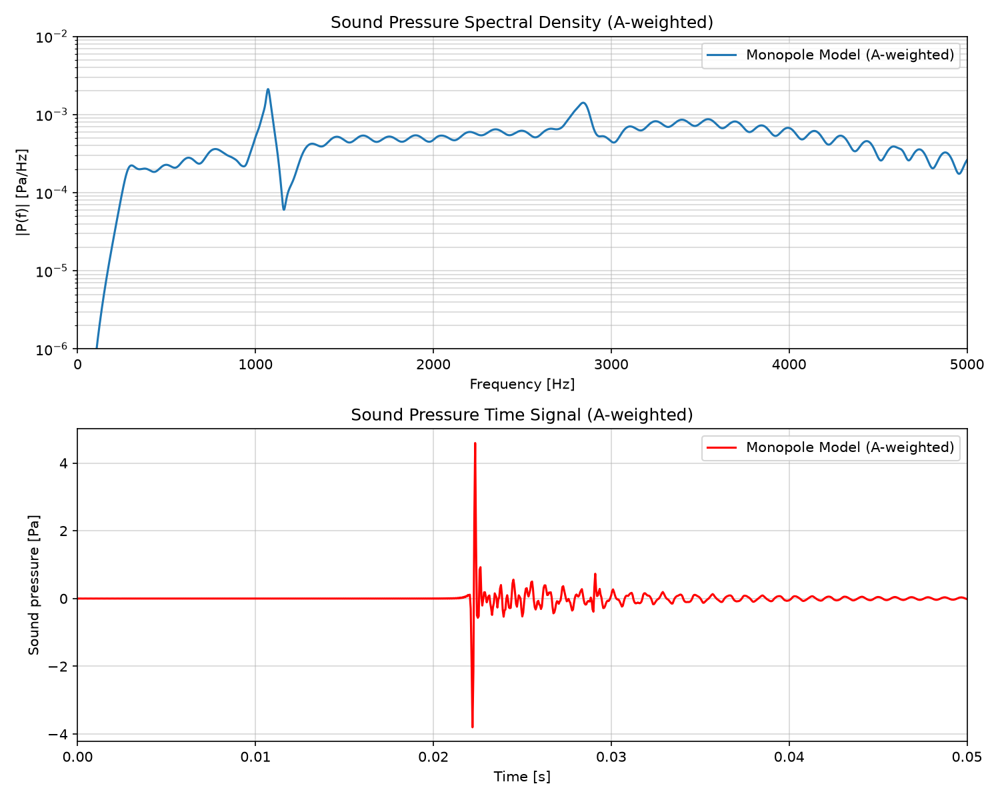

.. _radiation_vertical_impulse:

Sound Radiation of a Vertically Excited Rail
============================================

This example simulates the sound radiation of a discrete slab track (1-layer discr.) excited vertically by a Gaussian impulse.
The rail is supported by discrete pads on a rigid slab.
The full deflection wavefield of the rail is recorded and radiated to a receiver at 7.5 m lateral distance
using a simplified monopole model: every surface triangle of the rail mesh acts as a monopole source.
The resulting A-weighted sound pressure is plotted and exported as a calibrated WAV file.

.. note:: The radiation module is still under development and has not yet been validated against measurements
   or reference models.

.. note:: The radiation model requires the full wavefield, i.e. ``Deflection(store="full")``. Use ``skip`` to
   reduce the stored time steps and memory usage (here ``skip=10`` gives an effective sample rate of 20 kHz).

.. note:: By default, plots and WAV export use A-weighted results according to IEC 61672-1
   (``a_weighting=True``). The unweighted results remain available as ``sp_freq``, ``sp_density`` and ``sp_time``.
   Set ``a_weighting=False`` to use them in ``show()`` and ``to_wav()``.

.. note:: The WAV file is physically calibrated: a sample value of 1.0 (0 dBFS) corresponds to 20 Pa, i.e.
   :math:`L_{SPL} = L_{dBFS} + 120\,\mathrm{dB}`. Use ``to_wav(normalize=True)`` for playback only.

.. code-block:: python
  :caption: Python Code
  :linenos:

    """
    Example: Sound Radiation of a Vertically Excited Rail

    This example demonstrates how to:
        1. Create a slab track model with discrete pads
        2. Excite the rail vertically with a Gaussian impulse
        3. Record the full deflection wavefield
        4. Calculate the radiated sound pressure with a monopole model
        5. Plot the results and export a calibrated WAV file
    """

    import numpy as np
    from matplotlib import pyplot as plt
    from rolland import DiscrPad
    from rolland.database.rail.db_rail import rail_60E1
    from rolland.track import SimplePeriodicSlabSingleRailTrack
    from rolland.boundary import CFSPML
    from rolland.excitation import GaussianImpulse
    from rolland.deflection import Deflection
    from rolland.domainsetup import DomSetup
    from rolland.radiation import SimplifiedMonopoleRadiation

    # 1. TRACK DEFINITION ----------------------------------------------------------
    # Discrete slab track (1-layer discr.): rail on discrete pads on a rigid slab
    pad = DiscrPad(
        # Stiffness [N/m]
        sp_z=120e6,
        sp_y=40e6,
        sp_x=40e6,

        # Damping loss factors [-]
        etap_z=0.2,
        etap_y=0.2,
        etap_x=0.2,
        etap_r=0.2,

        # Geometry [m]
        wdthp=0.15,
    )

    track = SimplePeriodicSlabSingleRailTrack(
        rail=rail_60E1,
        pad=pad,
        z_f=81e-3,
        y_f=0,
        num_mount=100,
    )

    # 2. BOUNDARY & EXCITATION -----------------------------------------------------
    bound = CFSPML()
    exc_vert = GaussianImpulse(x_excit=30.3)

    # 3. SIMULATION ----------------------------------------------------------------
    discr = DomSetup(
        track=track,
        bound=bound,
        req_simt=0.5,
    )

    # Full wavefield required for radiation; skip=10 stores every 10th time step
    defl = Deflection(
        discr=discr,
        excit=exc_vert,
        store="full",
        skip=10,
    )

    # 4. RADIATION -----------------------------------------------------------------
    # 10 m rail section centred at the excitation point,
    # receiver at 7.5 m lateral distance and 1.2 m height.
    # A-weighting (IEC 61672-1) is applied to plots and WAV export (default);
    # unweighted results remain available as rad.sp_freq, rad.sp_density, rad.sp_time
    rad = SimplifiedMonopoleRadiation(
        result=defl,
        rail=rail_60E1,
        measurement_point=np.array([30.3, 7.5, 1.2]),
        mesh_length=10.0,
        mesh_size=0.05,
        a_weighting=True,
    )

    # 5. POSTPROCESSING & VISUALIZATION --------------------------------------------
    fig, (ax1, ax2) = plt.subplots(2, 1, figsize=(10, 8))

    rad.show(ax=ax1, quantity="density", label="Monopole Model (A-weighted)")
    ax1.set_xlim(0, 5000)
    ax1.set_ylim(1e-6, 1e-2)

    rad.show(ax=ax2, quantity="time", label="Monopole Model (A-weighted)", color="r")
    ax2.set_xlim(0, 0.05)

    plt.tight_layout()
    plt.show()

    # Calibrated A-weighted WAV export: 0 dBFS corresponds to 20 Pa (120 dB(A))
    rad.to_wav("radiation_vertical_impulse.wav")

The sound pressure arrives at the receiver after approximately 22 ms, which corresponds to the propagation
time over the distance of about 7.6 m.
The resulting audio file can be downloaded here: :download:`radiation_vertical_impulse.wav <radiation_vertical_impulse.wav>`.
